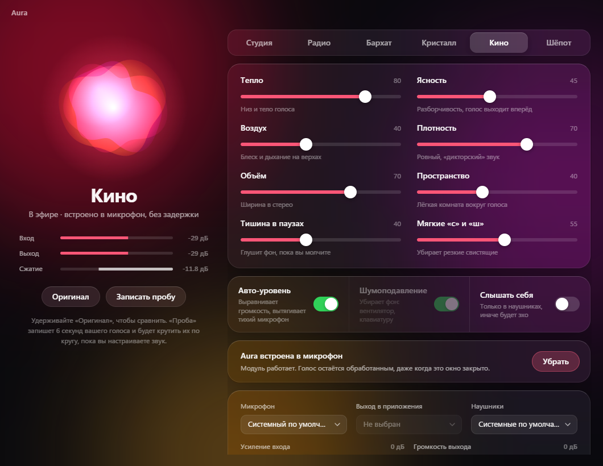

# Aura

Студийная обработка голоса с микрофона в реальном времени для Windows: тепло, ясность, воздух, плотность, объём — и интерфейс, на который приятно смотреть.


## Что умеет

- **Характер голоса** — шесть пресетов и свой: тепло, ясность, воздух, плотность, объём, пространство, тон голоса.
- **Шумоподавление на нейросетях** — быстрый RNNoise (10 мс) или качественный DeepFilterNet 3 (40 мс), с регулятором силы.
- **Комната и микрофон** — тишина в паузах, анти-хлопок, подавление эха комнаты, авто-уровень, автонастройка.
- **Контроль** — сравнение с оригиналом, проба голоса по кругу, индикаторы уровня, сжатия и громкости в LUFS.
- **Удобство** — трей, горячие клавиши (Ctrl+Shift+F9 — обработка, Ctrl+Shift+F10 — заглушить микрофон), пресеты в файлах.

## Системный режим

Кнопка «Встроить» ставит модуль прямо в микрофон Windows — так же, как это делает Clownfish. После этого обработанный голос слышат все программы, виртуальный кабель не нужен, а в Discord и играх остаётся ваш обычный микрофон.



Готовые `AuraAPO.dll` и `AuraSetup.exe` собираются в GitHub Actions; положите их в `native/bin`.

## Запуск

```
npm install
npm start
```

## Как это устроено

- `app/` — окно приложения (Electron) и обработка на Web Audio.
- `native/` — системный модуль (APO), который встраивается в микрофон Windows, чтобы обработанный голос слышали все программы без виртуального кабеля.

## Скачать

Установщик — на странице [релизов](https://github.com/cxxperman/aura-voice/releases). Сборка ранняя и пока не подписана: Windows SmartScreen покажет предупреждение «неизвестный издатель».

Удаление: «Параметры Windows → Приложения → Aura → Удалить». Перед удалением модуль сам снимается с микрофона; вручную это делает кнопка «Убрать» в настройках Aura.

## Приватность

- Aura не собирает и никуда не отправляет ваш голос, записи, настройки или сведения о компьютере. Телеметрии нет.
- При запуске приложение спрашивает у GitHub (`api.github.com`), вышла ли новая версия; GitHub при этом видит ваш IP-адрес и номер установленной версии. Обновление скачивается и ставится только по вашему нажатию. Проверку можно выключить: «Настройки → Проверять обновления».
- Весь звук обрабатывается на вашем компьютере.
- Второй и последний случай обращения в сеть: когда вы открываете раздел «Звуки», оно запрашивает список звуков у `uwupad.me` и скачивает выбранные с `cdn.uwupad.me`. Этим сайтам видны ваш IP-адрес и поисковый запрос. Если раздел «Звуки» не открывать, этих запросов нет.
- Настройки хранятся локально: в профиле приложения и в `%ProgramData%\Aura`.

## Code signing policy

Релизы пока не подписаны. Планируется заявка на бесплатную подпись для открытых проектов; после одобрения подпись будет такой:

Free code signing provided by [SignPath.io](https://signpath.io), certificate by [SignPath Foundation](https://signpath.org).

- Committers and reviewers: [cxxperman](https://github.com/cxxperman)
- Approvers: [cxxperman](https://github.com/cxxperman)

Все файлы релиза собираются автоматически из исходников этого репозитория (`.github/workflows/native.yml`); вручную собранные файлы не публикуются.

## Лицензия

[MIT](LICENSE). В состав входят [RNNoise](https://github.com/xiph/rnnoise) (BSD-3-Clause) и [DeepFilterNet](https://github.com/Rikorose/DeepFilterNet) (MIT / Apache-2.0); их лицензии лежат рядом с модулем.
