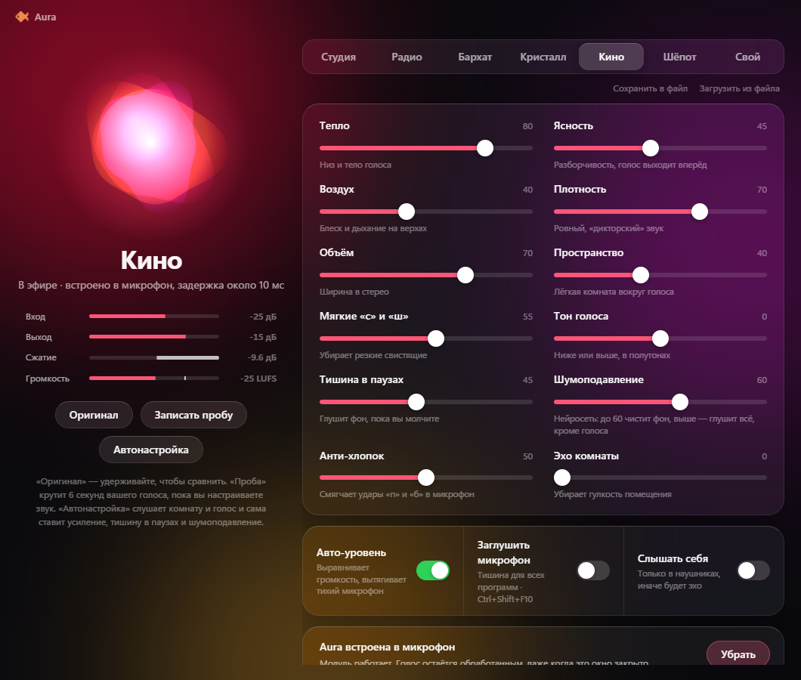

# Aura

Студийная обработка голоса с микрофона в реальном времени для Windows: тепло, ясность, воздух, плотность, объём — и интерфейс, на который приятно смотреть.



## Что умеет

- **Характер голоса** — шесть пресетов и свой: тепло, ясность, воздух, плотность, объём, пространство, тон голоса.
- **Шумоподавление на нейросетях** — быстрый RNNoise (10 мс) или качественный DeepFilterNet 3 (40 мс), с регулятором силы.
- **Комната и микрофон** — тишина в паузах, анти-хлопок, подавление эха комнаты, авто-уровень, автонастройка.
- **Контроль** — сравнение с оригиналом, проба голоса по кругу, индикаторы уровня, сжатия и громкости в LUFS.
- **Удобство** — трей, горячие клавиши (Ctrl+Shift+F9 — обработка, Ctrl+Shift+F10 — заглушить микрофон), пресеты в файлах.

## Системный режим

Кнопка «Встроить» ставит модуль прямо в микрофон Windows — так же, как это делает Clownfish. После этого обработанный голос слышат все программы, виртуальный кабель не нужен, а в Discord и играх остаётся ваш обычный микрофон.


Готовые `AuraAPO.dll` и `AuraSetup.exe` собираются в GitHub Actions; положите их в `native/bin`.

## Запуск

```
npm install
npm start
```

## Как это устроено

- `app/` — окно приложения (Electron) и обработка на Web Audio.
- `native/` — системный модуль (APO), который встраивается в микрофон Windows, чтобы обработанный голос слышали все программы без виртуального кабеля.
